# Face Liveness Detection and Authentication Kiosk

**HID Global hackathon · "Can You Spot a Spoof?"** plus the surprise challenge **"Secure Access Beyond Liveness"**

A door-access kiosk that decides **ALLOW**, **STEP-UP VERIFICATION** or **DENY** in under two seconds. For every scan it answers four questions: is the face **live** (not a photo, screen, video or mask), is it the **right person** for the badge, is that person **allowed through this door right now**, and has the badge been **locked out** by repeated failures.

Runs on AWS (Lambda, API Gateway, Rekognition, DynamoDB, KMS). Server-side decision time on the deployed Lambda is **about 0.2 to 0.4 s**.

> **Status:** working prototype. See [Results](#results) and [Limitations](#limitations-and-roadmap) for what is and is not measured or built.

---

## Table of contents

1. [Screenshots](#screenshots)
2. [Key features](#key-features)
3. [Architecture](#architecture)
4. [How a decision is made](#how-a-decision-is-made)
5. [Campus access policy](#campus-access-policy)
6. [Tech stack](#tech-stack)
7. [AWS resources](#aws-resources)
8. [API reference](#api-reference)
9. [Getting started](#getting-started)
10. [Deployment](#deployment)
11. [Testing and evaluation](#testing-and-evaluation)
12. [Results](#results)
13. [Security and privacy](#security-and-privacy)
14. [Limitations and roadmap](#limitations-and-roadmap)
15. [Repository layout](#repository-layout)
16. [Data sources and licences](#data-sources-and-licences)
17. [Team](#team)

---

## Screenshots

Captured from the **deployed** site (Chrome driven by Playwright, with a fake camera fed from public test-set frames, so every request really goes through API Gateway, Lambda, Rekognition and DynamoDB). The camera preview is blurred because dataset faces are not published. "Decision time" on screen is measured from the laptop (upload plus network, about 1 s); the server-side time shown beneath it is about 0.3 s. Regenerate with `tools/capture_screenshots.py`.

| | |
|---|---|
| **Kiosk home with the access-rules table** <br> 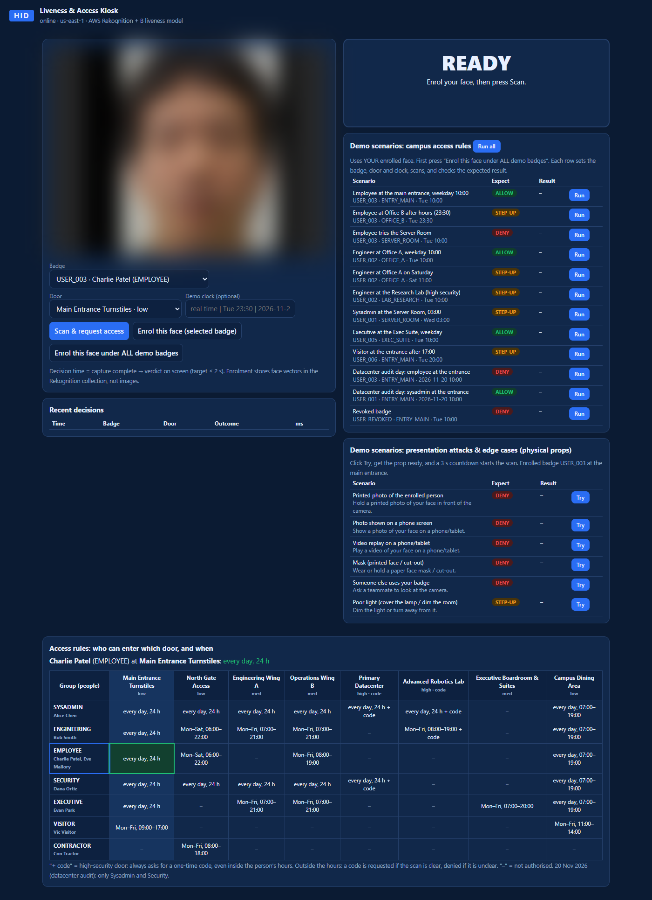 | **Enrolling a face under all demo badges** <br> 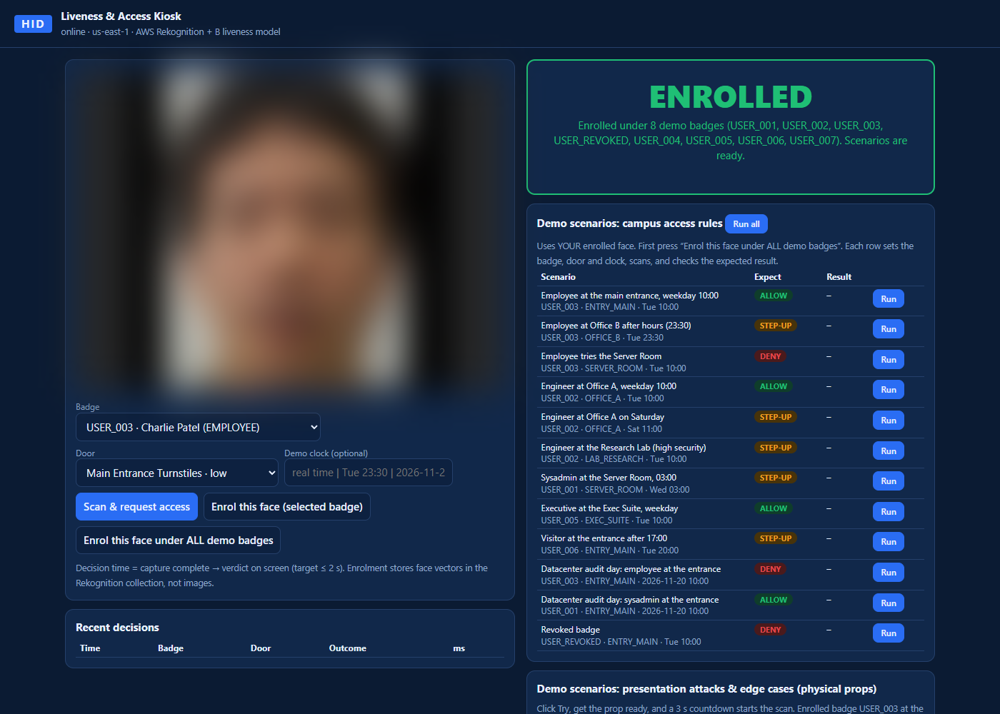 |
| **ALLOW**: genuine employee, main entrance <br> 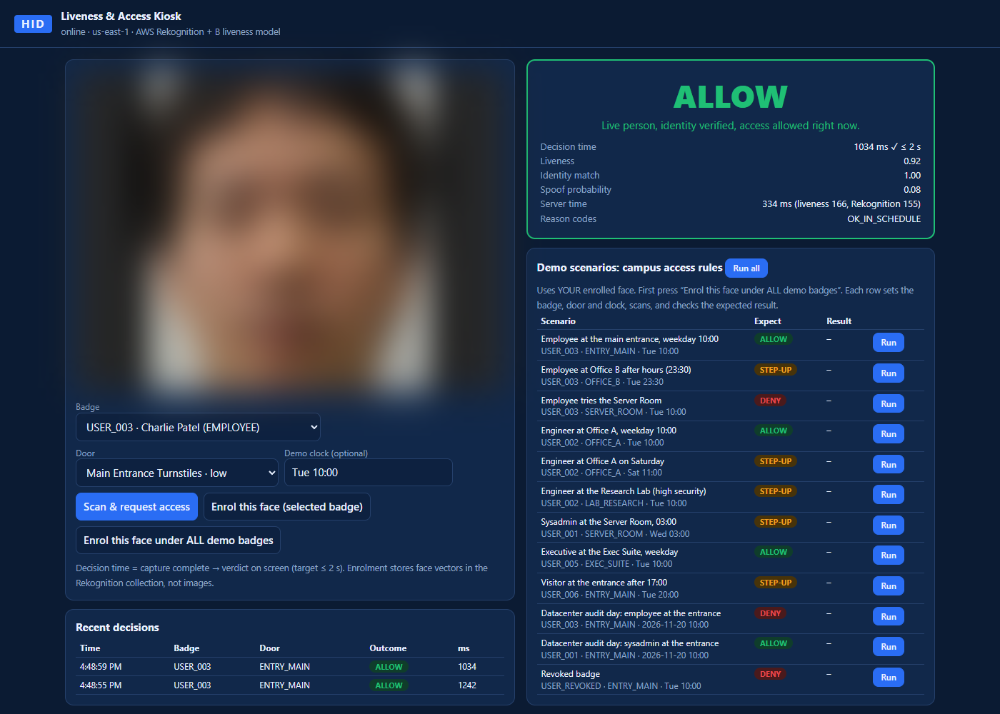 | **STEP-UP**: outside permitted hours <br> 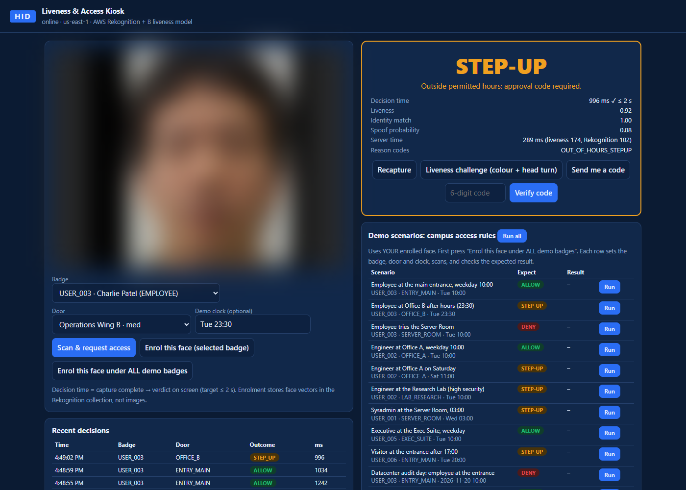 |
| **DENY**: door not authorised for the group <br> 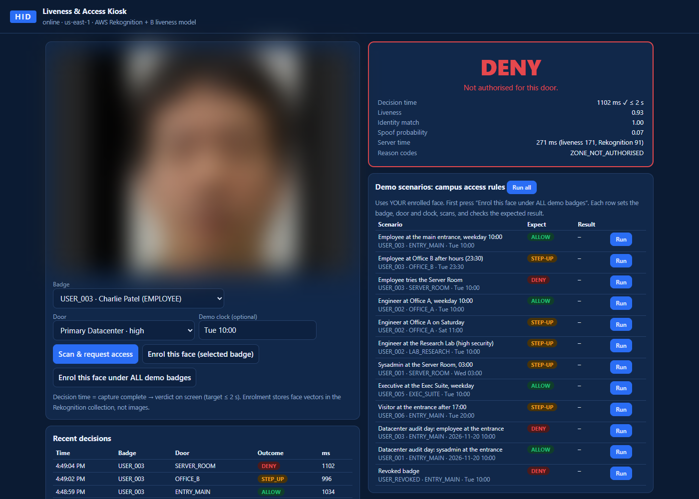 | **DENY**: datacenter audit day (admin only) <br>  |
| **STEP-UP**: high-security door needs a second factor <br>  | **ALLOW** after the one-time code is verified <br> 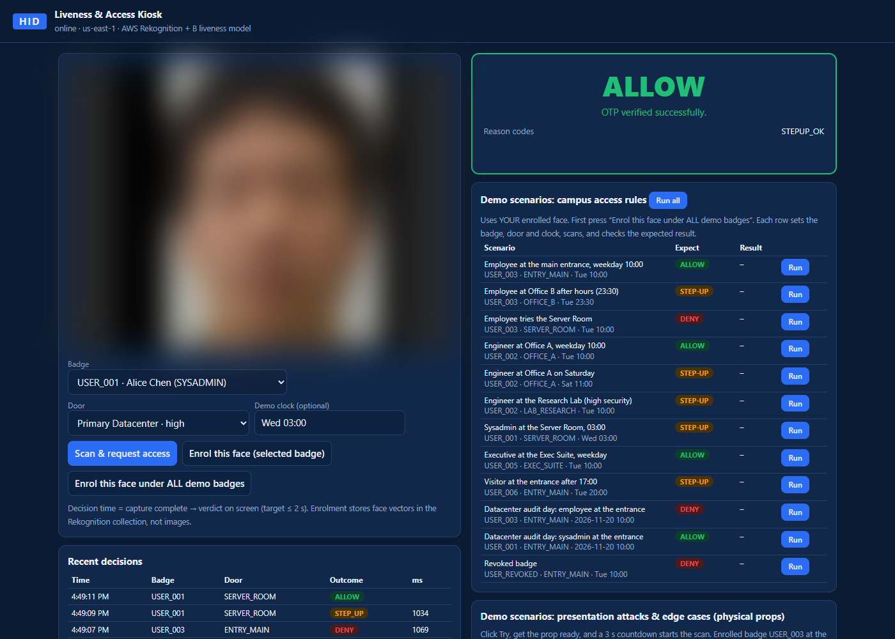 |
| **DENY**: printed-photo attack <br> 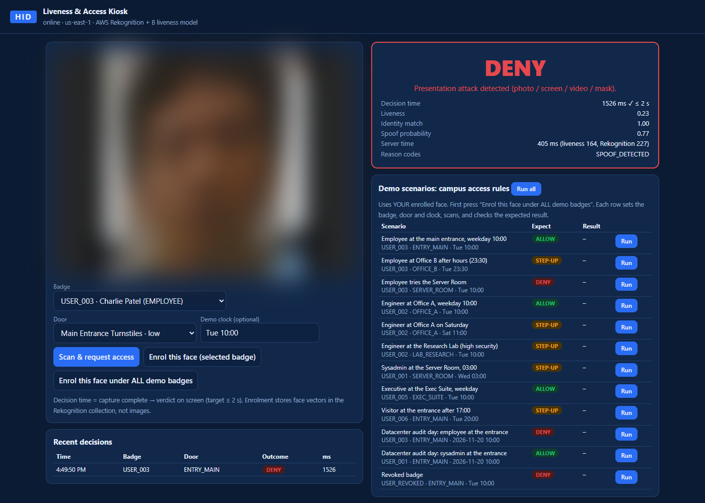 | **DENY**: badge locked after 3 failed attempts <br> 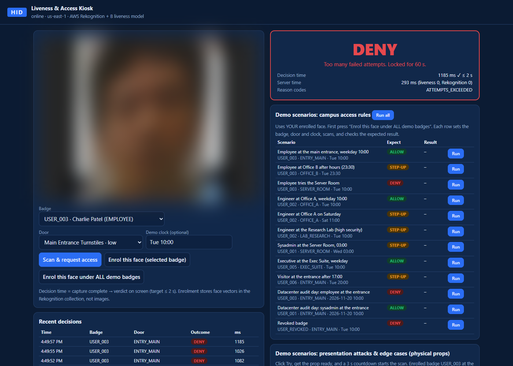 |
| **DENY**: video-replay attack <br> 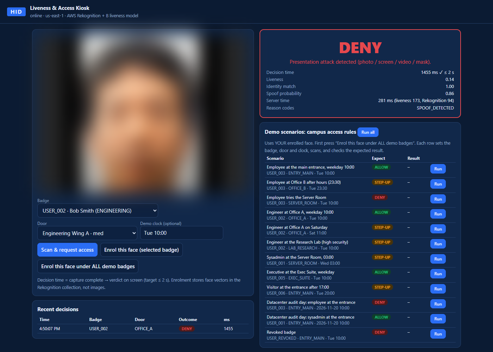 | **One-click scenario runner** (12 campus rules, expected vs actual) <br> 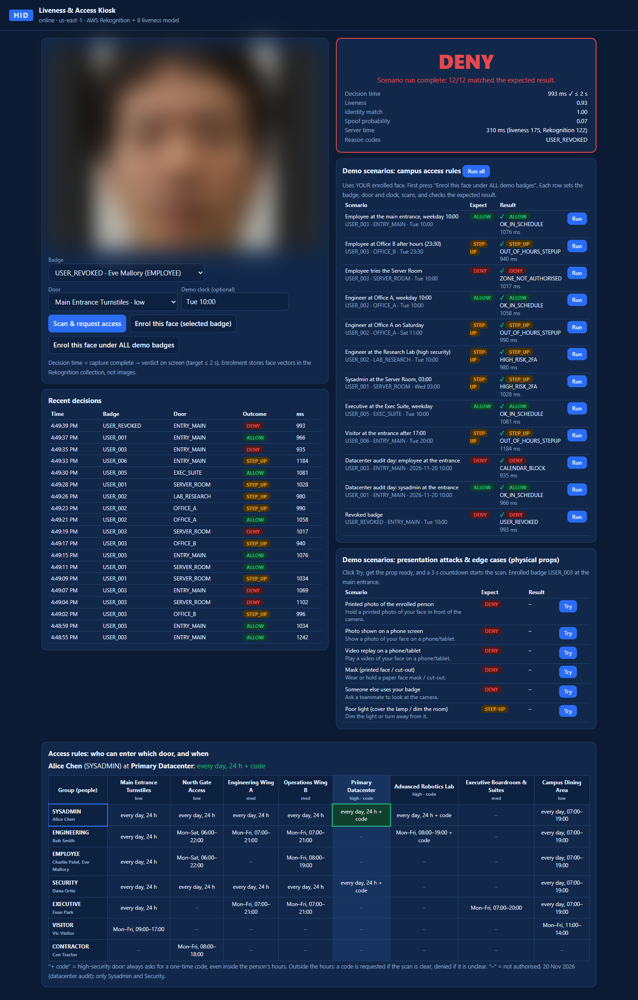 |

---

## Key features

- **Liveness (presentation-attack detection).** A MobileNetV3-small model on a 2x context crop (so phone bezels, paper edges and hands stay in view) plus classical cues: screen moiré, glare, flatness, frame edges and rigid-versus-natural motion. Catches printed photos, screen photos, video replays and masks.
- **Identity.** Amazon Rekognition face search against a collection; only a match to the *claimed badge* counts. The collection stores face vectors, never photos.
- **Fusion.** Rule-based combination of liveness, identity and image quality with thresholds that tighten with door risk (low, medium, high). Any strong spoof signal is an automatic deny.
- **Context-aware access control.** Account status, validity dates, calendar (holidays, audit day), door permission, weekday and time window, and door risk, evaluated "most restrictive wins" and returned with machine-readable reason codes.
- **Step-up verification.** Recapture, a **Tier 2 challenge** (random colour flash plus random head turn, verified by a synchrony test so a replayed video cannot pass), or a one-time code. High-security doors always require a second factor.
- **Replay and brute-force defence.** Single-use nonces, and a lockout after 3 failed biometric attempts.
- **Fail closed.** Any error or unreadable state is a DENY, never an ALLOW.
- **Audit trail.** Every decision is logged to DynamoDB with reason codes and timings, using hashed badge IDs and no images.
- **Demo website.** Browser kiosk with burst capture, 12 one-click campus-rule scenarios, 6 physical attack and edge-case scenarios, and a table of who can enter which door and when.

---

## Architecture

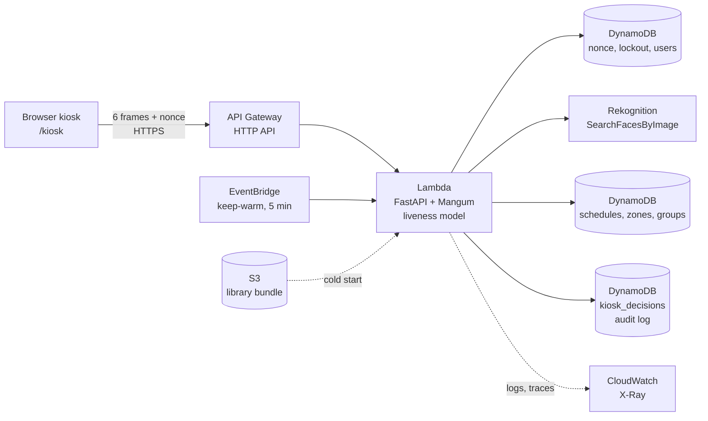

The Lambda is a zip package whose heavy libraries (NumPy, OpenCV, ONNX Runtime, about 80 MB) are stored in S3 and unpacked into `/tmp` on cold start, because the zip size limit is 250 MB.

---

## How a decision is made

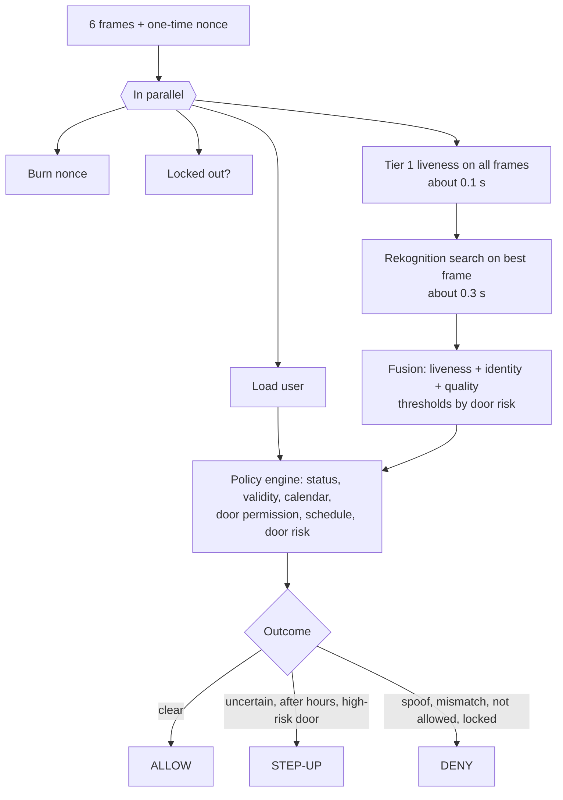

### 1. Tier 1 liveness (`models/liveness/`)

1. **Face detection** with OpenCV YuNet picks the sharpest, best-lit frame.
2. **Context crop**: a 2x box, resized to 160 x 160.
3. **CNN**: MobileNetV3-small (ONNX, 6 MB, about 10 ms) outputs five probabilities: live, print, screen photo, video replay, mask. `spoof_prob = 1 - P(live)`, averaged over the best three frames.
4. **Cues**: moiré (FFT peaks), glare, flatness (high-frequency energy), frame edges (Hough lines), non-rigid motion (optical flow).
5. **Blend**: `spoof_prob = min(1, 0.8 x CNN + 0.2 x cues)` with cue weights moiré 0.35, rigid motion 0.20, glare 0.15, flatness 0.15, edges 0.15. These weights were set by hand, not learned.

### 2. Identity (Amazon Rekognition)

`search_faces_by_image` on the best frame against collection `kiosk-face-collection-v1`. Similarity counts only if the matched `ExternalImageId` equals the claimed badge. A second identical search fires if the first has not answered within 0.9 s (hedged request).

### 3. Fusion (`backend/fusion.py`, `config/thresholds.v2.json`)

Evaluated in order, first match wins: hard spoof veto (moiré or edge cue 0.95, CNN 0.97, blended spoof probability 0.98) → identity below deny → Tier 2 failed → poor quality (step-up, recapture) → liveness at or below deny → identity and liveness both at or above allow (ALLOW) → otherwise STEP-UP.

| Door risk | Liveness allow | Liveness deny | Identity allow | Identity deny |
|---|---|---|---|---|
| Low (entrances, cafeteria) | 0.75 | 0.50 | 0.90 | 0.70 |
| Medium (offices, executive suite) | 0.80 | 0.50 | 0.92 | 0.75 |
| High (server room, robotics lab) | 0.85 | 0.50 | 0.95 | 0.80 |

Liveness is `1 - spoof_prob`; identity is Rekognition similarity divided by 100. Thresholds are **draft** and hot-reloaded from the file when running locally.

### 4. Policy engine (`backend/policy_engine.py`)

Checked in order: spoof → unknown badge → identity mismatch → revoked or expired → calendar block → door not authorised → schedule window → door risk. Outside the schedule: STEP-UP for a clear scan, DENY for an unclear one. Door risk is derived from each door's `security_tier` (1 low, 2 medium, 3 high); tier-3 doors always require a second factor. Door risk, user status, schedule rows and calendar come from [`config/seed_campus.json`](config/seed_campus.json) and DynamoDB (`kiosk_zones`, `kiosk_users`, `kiosk_schedules`, `kiosk_groups`).

### 5. Step-up, lockout and audit

- **Tier 2 challenge** (`/challenge`, `/challenge/verify`): six random screen colours plus a random head turn. The face's colour response must follow the issued sequence better than random sequences (permutation test), and the head must turn the requested way. Single use, short expiry.
- **One-time code**: 6 digits, stored hashed in DynamoDB, 5-minute life, 3 wrong tries lock it. The demo returns the code on screen (`OTP_DEMO=1`); in production it would be sent by SES or SNS.
- **Lockout**: 3 failed biometric attempts per badge lock it for 60 s. Policy denials such as a wrong door do not count.
- **Audit**: one row per decision in `kiosk_decisions`.

---

## Campus access policy

Hours are 24-hour clock. "+ code" means the door always asks for a one-time code.

| Group (demo user) | Main Entrance | North Gate | Cafeteria | Office A | Office B | Exec Suite | Robotics Lab | Server Room |
|---|---|---|---|---|---|---|---|---|
| **Employee** (`USER_003`, and the revoked `USER_REVOKED`) | daily, 24 h | Mon–Sat 06–22 | daily 07–19 | none | Mon–Fri 08–19 | none | none | none |
| **Engineering** (`USER_002`) | daily, 24 h | Mon–Sat 06–22 | daily 07–19 | Mon–Fri 07–21 | Mon–Fri 07–21 | none | Mon–Fri 08–19 + code | none |
| **Sysadmin** (`USER_001`) | daily, 24 h | daily, 24 h | daily 07–19 | daily, 24 h | daily, 24 h | none | daily, 24 h + code | daily, 24 h + code |
| **Security** (`USER_004`) | daily, 24 h | daily, 24 h | daily 07–19 | daily, 24 h | daily, 24 h | none | none | daily, 24 h + code |
| **Executive** (`USER_005`) | daily, 24 h | none | daily 07–19 | Mon–Fri 07–21 | Mon–Fri 07–21 | Mon–Fri 07–20 | none | none |
| **Visitor** (`USER_006`) | Mon–Fri 09–17 | none | Mon–Fri 11–14 | none | none | none | none | none |
| **Contractor** (`USER_007`) | none | Mon–Fri 08–18 | none | none | none | none | none | none |

Special day: **20 Nov 2026** (datacenter audit), only Sysadmin and Security may enter anywhere. Door risk: entrances and cafeteria low; offices and executive suite medium; robotics lab and server room high. The demo data is synthetic. This table is verified against the policy engine (18,816 group x door x day x time checks).

---

## Tech stack

| Layer | Technology |
|---|---|
| Backend | Python 3.12, FastAPI, Mangum (Lambda adapter), boto3 |
| Liveness model | PyTorch and timm (training), MobileNetV3-small exported to ONNX, ONNX Runtime (inference) |
| Computer vision | OpenCV (YuNet face detection, optical flow, Hough, FFT cues), NumPy |
| Identity | Amazon Rekognition (face collection and search) |
| Frontend | HTML, CSS and vanilla JavaScript kiosk (webcam capture, colour-flash challenge); browser inference snippet with ONNX Runtime Web |
| AWS | Lambda, API Gateway (HTTP API), DynamoDB, S3, KMS, EventBridge, CloudWatch, X-Ray, IAM |
| Tooling | pytest, Playwright (screenshots), Docker (optional image build), Git |

---

## AWS resources

Region `us-east-1`.

| Resource | Name | Purpose |
|---|---|---|
| Lambda | `hidb-kiosk-backend` | Whole backend (2 GB, 60 s, X-Ray on) |
| API Gateway (HTTP API) | `hidb-kiosk-backend` | Public HTTPS entry point and kiosk page |
| Rekognition collection | `kiosk-face-collection-v1` | Enrolled face vectors, labelled by badge |
| DynamoDB | `kiosk_users`, `kiosk_zones`, `kiosk_groups`, `kiosk_schedules` | Campus data |
| DynamoDB | `kiosk_sessions` | Nonces, challenges, lockouts, one-time codes (TTL) |
| DynamoDB | `kiosk_decisions`, `kiosk_sync_batches` | Audit log and offline-sync batches |
| KMS | `alias/kiosk-policy-signer` | Signs the offline policy bundle and credentials |
| S3 | `kiosk-evidence-…` | `hidb/deps*.zip` library bundles, evidence bucket |
| EventBridge | `hidb-kiosk-keepwarm` | Pings the Lambda every 5 minutes |
| CloudWatch | dashboard `hidb-kiosk`, 7-day logs | Latency, errors, traffic |
| IAM | `hidb-kiosk-lambda-role` | Least-privilege execution role |

---

## API reference

| Method and path | Purpose |
|---|---|
| `GET /kiosk` | The browser kiosk |
| `GET /health` | Health check |
| `GET /config` | Doors, users, schedules and calendar for the page |
| `POST /session` | Issue a single-use nonce (30 s) |
| `POST /decide` | Main decision. JSON `{nonce, frames[], badge_id, zone_id, now?}` or multipart. Returns `outcome`, `reasons`, `liveness`, `similarity`, `timings`, `detail`. `now` is an optional demo clock such as `"Tue 23:30"` |
| `POST /enroll` | Enrol one face for a badge (never changes group, status or validity) |
| `POST /demo/enrol-all` | Demo helper: index one face under every demo badge |
| `POST /challenge` and `POST /challenge/verify` | Tier 2 challenge: issue, then verify timestamped frames |
| `POST /generate-otp` and `POST /verify-otp` | One-time code step-up |
| `GET /policy-bundle`, `POST /credential`, `POST /sync` | Signed policy bundle, signed credential and offline-sync endpoints |
| `POST /face-liveness-session` | Creates a Rekognition Face Liveness session (not used by the page) |

Full contract: [`docs/openapi.yaml`](docs/openapi.yaml). Reason codes: [`config/reasons.json`](config/reasons.json).

---

## Getting started

**Prerequisites:** Python 3.12, an AWS account or sandbox with credentials in the environment (never in files), and the resources above (created by `infra/provision.py`).

```bash
pip install -r backend/requirements.txt
export AWS_DEFAULT_REGION=us-east-1                 # plus AWS_ACCESS_KEY_ID / SECRET / SESSION_TOKEN
python -m uvicorn backend.main:app --host 127.0.0.1 --port 8000
# open http://127.0.0.1:8000/kiosk
```

Use `127.0.0.1`, not `localhost`: on Windows `localhost` tries IPv6 first and adds about a second.

**Try it:** press *Enrol this face under ALL demo badges*, then press *Run all* in the scenarios panel, or use the physical attack scenarios with a printed photo or phone.

**Load or repair campus data**

```bash
python infra/seed_extra.py       # schedules + new users from config/seed_campus.json (never overwrites existing users)
python infra/repair_users.py     # restore name, group, status and validity of the demo users, keeping enrolled faces
```

**Retrain the liveness model** (about 4 minutes on a GPU): see [`models/train/`](models/train) and [`docs/DATASETS.md`](docs/DATASETS.md).

```bash
cd models
python train/prepare_public.py casia  --src ../data/downloads/casia/x --out ../data/crops
python train/train_cnn.py --epochs 12
python train/export_onnx.py          # writes artifacts/liveness_cnn.onnx (ship the fp32 file; INT8 broke accuracy)
```

---

## Deployment

```bash
python models/lambda/build_zip.py            # builds the heavy library bundle (Linux wheels, pruned)
python infra/deploy_zip.py                   # uploads libraries to S3, creates/updates Lambda, API Gateway, EventBridge rule
python infra/deploy_zip.py --extra-only      # redeploy code only (fast)
python infra/dashboard.py                    # CloudWatch dashboard
```

`Dockerfile.lambda` builds the same backend as a container image. The final deployment uses the zip route because the image push was too slow in the sandbox. The Lambda role must allow only our tables, the Rekognition collection, the signing key and the evidence bucket.

---

## Testing and evaluation

```bash
python -m pytest tests/test_policy_adapter.py tests/test_fusion.py tests/test_harness.py   # 23 tests (harness uses live AWS)
python -m pytest models/tests                                                              # liveness cues, Tier 2, Lambda handler
python tests/e2e_integrated.py --casia <CASIA dir> [--api https://<api>]                   # 11 end-to-end cases on real AWS, incl. lockout
python tests/latency_check.py  --casia <CASIA dir> [--api https://<api>]                   # decision-time distribution
python eval/aws_only_accuracy.py --crops data/crops --model models/artifacts/liveness_cnn.onnx
python tools/capture_screenshots.py --casia <CASIA dir> --url https://<api>/kiosk          # regenerate README screenshots
```

---

## Results

| Check | Result |
|---|---|
| Liveness model, frame level, public held-out test (1,329 images) | **96.2 %** accuracy (CASIA 98.4 %, CelebA-Spoof 93.3 %). Attacks accepted 3.0 %, live rejected 5.2 %. HID target is 99.4 %. |
| AWS Rekognition label checks alone, same images | Attacks accepted **91–95 %**, about 37 % accuracy. See [`docs/AWS_ONLY_ACCURACY.md`](docs/AWS_ONLY_ACCURACY.md). |
| End to end on real AWS (11 cases) | Genuine allowed; print, cut-out and video replay denied; impostor denied; wrong door, out-of-hours, audit day and lockout all correct. |
| Decision time on the deployed Lambda | Server **0.18–0.39 s**; cold start about 6 s; kept warm by EventBridge. |
| Automated tests | 23 pass (policy engine, fusion, live-AWS harness). |

Honest caveats: samples are small (wide confidence intervals); the CASIA test split was reused for diagnostics so it is not a clean final test; the model has not been trained or tested on our own camera, screen-photo attacks or masks; thresholds are draft.

---

## Security and privacy

- **No images stored.** Rekognition holds face vectors; audit rows hold hashed badge IDs and frame hashes.
- **Least privilege.** The Lambda role is scoped to named tables, one collection, one key and one bucket.
- **Replay protection.** Single-use nonces with a 30 s life; challenges and one-time codes are single use, hashed and expire.
- **Fail closed.** Errors deny; enrolment can never change a user's group, status or validity.
- **Signed offline artefacts.** The policy bundle and credentials are signed with an ECDSA P-256 key in KMS.
- **Demo caveats.** The demo API is public with no login and the one-time code is shown on screen. Before real use add an authorizer (Cognito or IAM), throttling, WAF or CloudFront, Secrets Manager for the OTP salt, and email or SMS delivery.

---

## Limitations and roadmap

**Not built or not measured**

- The **offline fail-safe mode in the browser** (connectivity detection, cached signed bundle, local decision flow, local audit queue, auto-sync). The offline policy rules and the server endpoints exist and are tested; see [`docs/OFFLINE_FALLBACK.md`](docs/OFFLINE_FALLBACK.md).
- **AWS Rekognition Face Liveness** (a route exists; the page does not use it and its accuracy is unmeasured).
- Training data for **screen-photo and mask** attacks, and data from our own cameras. Accuracy is below the 99.4 % target.
- Tier 2 has been tested on simulated reflections and real face frames, not on a real screen-lit face.
- **CASIA data caveat found late:** the dataset's `train_img` and `test_img` folders reuse subject numbers for *different people*. Our person-level split stays leak-free (the same number always lands in the same split), but scripts that group clips by number alone (the earlier 72-decision pipeline run and `eval_cnn.py` per-subject views) can mix two people, so treat those per-clip numbers as indicative. Re-evaluating keyed by (folder, subject) is on the roadmap. The screenshot tool uses a single folder for this reason.
- Policy as an AWS-managed service (Verified Permissions or Cedar); the rules are Python today. D's TypeScript engine is on another branch and not wired in.

**Roadmap:** collect consented own-camera data, retrain and calibrate, freeze thresholds, build the browser edge agent, add API authentication and alarms.

---

## Repository layout

```
backend/            FastAPI app, decision pipeline, fusion, policy engine, lockout, OTP, Tier 2, kiosk page (kiosk.html)
models/liveness/    Tier 1 model code, classical cues, Tier 2 challenge
models/artifacts/   liveness_cnn.onnx, YuNet face detector
models/train/       data preparation, training, ONNX export, evaluation
models/collect/     webcam data-collection tool
models/lambda/      Lambda handler and library bundle builder
models/web/         browser inference snippet and test vectors
models/tests/       cue, challenge and handler tests
config/             campus seed data, thresholds, reason codes
infra/              provisioning, seeding, repair, deploy and dashboard scripts
tests/              policy, fusion, live-AWS harness, end-to-end and latency tests
eval/               AWS-only accuracy experiment
tools/              screenshot capture
docs/               how it works, offline fallback, integration notes, datasets, OpenAPI, screenshots
lambda_boot.py      Lambda entry that loads libraries from S3 at cold start
memory.md           chronological project log
```

---

## Data sources and licences

Public research data was used for training and evaluation only and is **not redistributed** in this repository. See [`docs/DATASETS.md`](docs/DATASETS.md).

| Data or model | Use | Terms |
|---|---|---|
| CASIA-FASD (via Hugging Face) | Training and held-out evaluation | Research dataset |
| CelebA-Spoof sample (via Hugging Face) | Extra live or spoof training data | Research, non-commercial |
| OpenCV YuNet (opencv_zoo) | Face detection | MIT |
| MobileNetV3-small (timm, ImageNet weights) | Model backbone | Apache-2.0 |

Campus users, doors and schedules are synthetic. Screenshots blur the camera preview because dataset faces are not published.

---

## Team

Four-person hackathon team, one role each:

- **A: Cloud and backend**: AWS infrastructure, API, enrolment, signed bundle, credential and sync.
- **B: ML and liveness**: Tier 1 model, cues, Tier 2 challenge, integration and deployment.
- **C: Frontend and demo**: kiosk UI.
- **D: Data, evaluation and fusion**: fusion module, policy vectors, evaluation harness.

Project log: [`memory.md`](memory.md). Detailed design notes: [`docs/HOW_IT_WORKS.md`](docs/HOW_IT_WORKS.md), [`docs/INTEGRATION.md`](docs/INTEGRATION.md).
